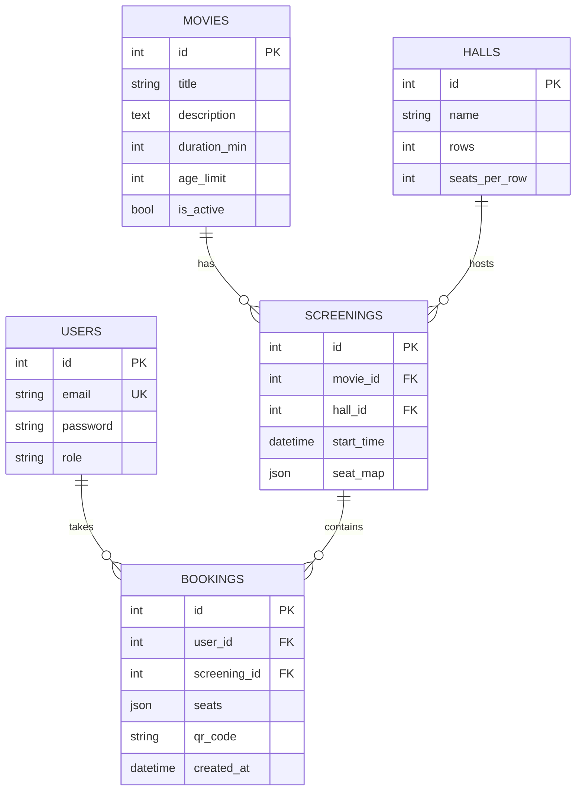

## ER-диаграмма кинотеатра

### Как читать связи:

| Запись | Смысл |
| :--- | :--- |
| `USERS \|\|--o{ BOOKINGS` | У одного пользователя ноль или много бронирований; у бронирования ровно один пользователь |
| `SCREENINGS \|\|--o{ BOOKINGS` | У одного сеанса ноль или много бронирований; у бронирования ровно один сеанс |
| `MOVIES \|\|--o{ SCREENINGS` | У одного фильма ноль или много сеансов; у сеанса ровно один фильм |
| `HALLS \|\|--o{ SCREENINGS` | У одного зала ноль или много сеансов; у сеанса ровно один зал |

### Ограничения, которые не всегда помещаются на диаграмму, выпишем отдельно:

| Таблица | PK | FK | Ограничения |
| :--- | :--- | :--- | :--- |
| `users` | `id` | — | `email` — UNIQUE; `password` — NOT NULL; `role` — CHECK ('admin', 'client') |
| `movies` | `id` | — | `title` — NOT NULL; `duration_min` — CHECK (> 0); `age_limit` — CHECK (0..18); `is_active` — BOOLEAN DEFAULT TRUE |
| `halls` | `id` | — | `name` — NOT NULL; `rows` — CHECK (> 0); `seats_per_row` — CHECK (> 0) |
| `screenings` | `id` | `movie_id` → `movies.id`, `hall_id` → `halls.id` | `start_time` — NOT NULL; `seat_map` — JSON DEFAULT `{}`; ON DELETE CASCADE для фильма, RESTRICT для зала |
| `bookings` | `id` | `user_id` → `users.id`, `screening_id` → `screenings.id` | `seats` — NOT NULL (JSON); `qr_code` — NOT NULL; `created_at` — DEFAULT NOW(); ON DELETE CASCADE для пользователя и сеанса |
